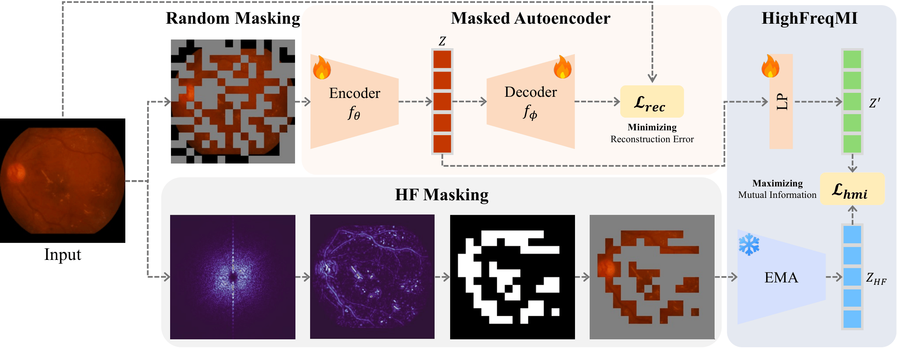

# RetMAE

Official PyTorch implementation of *Frequency-Balanced Retinal Representation
Learning with Mutual Information Regularization* (Lee et al., **ICLR 2026**) —
[OpenReview](https://openreview.net/forum?id=K5tcKEQaUr).

<p align="center">
  
</p>

> **TL;DR.** Standard masked autoencoders on retinal fundus images devote most
> of their reconstruction capacity to low-frequency tissue while neglecting the
> high-frequency micro-structures that drive clinical diagnosis. RetMAE
> rebalances pre-training along the frequency axis with three lightweight
> additions:
> 1. **Frequency-aware masking** that prefers masking high-frequency patches.
> 2. **Mutual-information regularization** between student features and an EMA
>    teacher of the high-frequency channel.
> 3. **Global-context distillation** from a frozen RetCLIP teacher.
>
> The encoder is a vanilla ViT-B/16, so the resulting checkpoint is a drop-in
> replacement for any MAE-style retinal encoder.

The total objective is

```
L = L_MAE  +  λ_distill · L_distill  +  λ_hmi · L_MI
```

with the high-frequency MI term activated after `model.high_freq_start_epoch`.
See the paper for the full derivation.

## Repository layout

```
configs/      Hydra configs (data, model, experiment, paths, ...)
scripts/      Bash entry points (pretrain, finetune, linprobe[_partial])
src/
├── pretrain.py                  pre-training entry
├── finetune.py                  downstream classification (DR, AMD, GL, RVO)
├── finetune_seg.py              downstream segmentation (IDRiD lesions)
├── finetune_data_efficient.py   data-efficient downstream sweeps
├── tasks/pretrain/              encoder, decoder, losses, datamodule, backbones
├── tasks/transfer/              shared helpers across the finetune entries
└── utils/                       logging, instantiators, path helpers
```

## Installation

```bash
conda env create -f environment.yaml
conda activate fundus-pretrain

cp .env.example .env
$EDITOR .env        # set DATA_ROOT, CKPT_ROOT, OUTPUT_ROOT
```

`rootutils` loads `.env` automatically when you import `src/pretrain.py` or
`src/finetune.py`. Three variables are read:

| Variable      | Purpose |
|---------------|---------|
| `DATA_ROOT`   | Parent of `DATASET_UNIFIED_V1/` and `DATASET_EXTERNAL_EVAL_224/`. |
| `CKPT_ROOT`   | Parent of pre-trained encoder weights (RetMAE + baselines). |
| `OUTPUT_ROOT` | Where Hydra writes run outputs. Default: `<repo>/outputs`. |

The pre-training corpus and the 224×224 downstream sets follow the layout
referenced in `configs/data/pretrain/250k.yaml` and
`configs/data/finetune/{dr,amd,gl,rvo}.yaml`. Source datasets are public; we do
not redistribute them.

## Pre-training

```bash
bash scripts/pretrain.sh
```

This wraps:

```bash
python src/pretrain.py \
    experiment=pretrain/retmae_retclip \
    trainer.devices=2 \
    trainer.max_epochs=100 \
    model.lambda_hmi=0.01 model.lambda_distill=1 \
    model.encoder.mask_ratio=0.3
```

Override any field on the command line; switch tracker with `logger=mlflow`
(or `wandb`, `aim`).

## Fine-tuning and linear probing

```bash
# Full fine-tuning of a RetMAE encoder on Diabetic Retinopathy
CKPT_PATH=$CKPT_ROOT/retmae/encoder_epoch_0000099.pth \
    bash scripts/finetune.sh

# Linear probing
CKPT_PATH=$CKPT_ROOT/retmae/encoder_epoch_0000099.pth \
    bash scripts/linprobe.sh

# Switch downstream task
... bash scripts/finetune.sh data=finetune/amd      # or dr / gl / rvo

# Compare against a baseline encoder
MODEL=retfound bash scripts/finetune.sh             # or flair / keepfit / retclip / urfound
```

Segmentation (IDRiD lesions, paper Table 2) and the data-efficient regime
(paper Table 3) are run directly:

```bash
CKPT_PATH=... python src/finetune_seg.py \
    experiment=finetune/retmae \
    model.encoder.ckpt_path=$CKPT_PATH

CKPT_PATH=... python src/finetune_data_efficient.py \
    experiment=finetune/retmae \
    model.encoder.ckpt_path=$CKPT_PATH
```

The partial-frequency probe (paper §4 ablation) is in `scripts/linprobe_partial.sh`:

```bash
CKPT_PATH=... MODE=high_freq  bash scripts/linprobe_partial.sh
CKPT_PATH=... MODE=low_freq   bash scripts/linprobe_partial.sh
CKPT_PATH=... MODE=random25   bash scripts/linprobe_partial.sh
CKPT_PATH=... MODE=random75   bash scripts/linprobe_partial.sh
```

## Baselines

External baseline encoders ship as thin wrappers under
`src/tasks/pretrain/backbone/` and are loaded from `$CKPT_ROOT`. You must
obtain the original weights from the upstream maintainers and respect each
baseline's license.

| Wrapper        | Upstream                                                     | File path under `$CKPT_ROOT` |
|----------------|--------------------------------------------------------------|------------------------------|
| RETFound (CFP) | https://github.com/rmaphoh/RETFound_MAE                      | `retfound/RETFound_cfp_weights.pth` |
| RETFound (DINOv2) | https://github.com/rmaphoh/RETFound_MAE                   | `retfound/RETFound_dinov2_shanghai.pth` |
| RETFound (MAE) | https://github.com/rmaphoh/RETFound_MAE                      | `retfound/RETFound_mae_shanghai.pth` |
| RET-CLIP       | https://github.com/Zoxin-DU/RET-CLIP                         | `retclip/ret-clip.pt` |
| FLAIR          | https://github.com/jusiro/FLAIR                              | `flair/flair_resnet.pth` |
| KeepFIT        | https://github.com/jusiro/FLAIR                              | `keepfit/KeepFIT (flair+MM).pth` |
| UrFound        | https://github.com/yukkai/UrFound                            | `urfound/urfound_mm.pth` |
| UniMed-CLIP    | https://github.com/mbzuai-oryx/UniMed-CLIP                   | `unimedclip/unimed_clip_vit_b16.pt` |
| ViLReF         | https://github.com/T6Yang/ViLReF                             | `vilref/ViLReF_ViT.pt` |

## Citation

The official proceedings entry is not yet available; please use the following
BibTeX (mirrored from Google Scholar) in the meantime.

```bibtex
@inproceedings{leefrequency,
  title={Frequency-Balanced Retinal Representation Learning with Mutual Information Regularization},
  author={Lee, Seunghoon and Kang, Seongjae and Park, Inhyuk and Kwon, Gitaek and Baek, Jihyeon and Park, Doohyun},
  booktitle={The Fourteenth International Conference on Learning Representations}
}
```

## Acknowledgements

Code structure inspired by `facebookresearch/mae`, `rmaphoh/RETFound_MAE`, and
the `ashleve/lightning-hydra-template`.

## License

© VUNO Inc. All rights reserved. See `LICENSE`.
